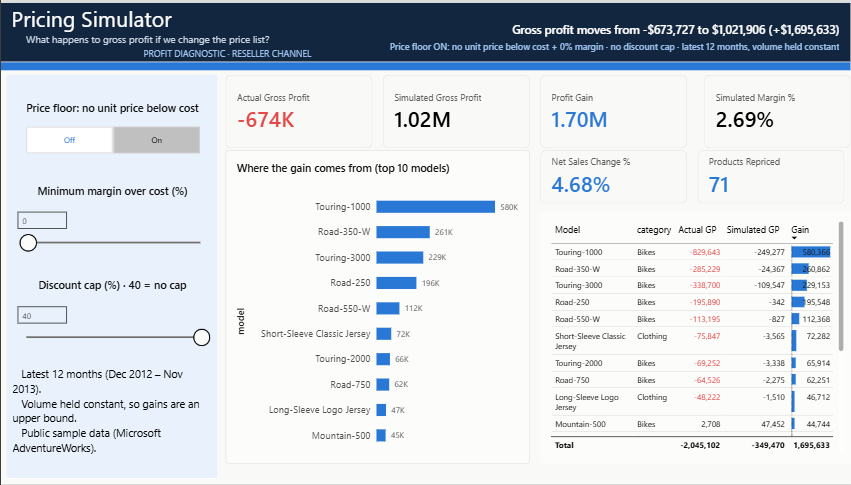

# Profit Diagnostic — Reseller Channel (AdventureWorks)

**Sales grew 29.8%. Gross profit fell $1.83M.** This project finds out why, using the methods finance teams use: profitability by product and customer, a price-volume-mix bridge, a price waterfall, and repricing scenarios, plus a Power BI simulator to test the fix.

> Public sample data: Microsoft **AdventureWorksDW2022**, reseller sales (`FactResellerSales`), a fictional bicycle company. Findings demonstrate the method, not facts about a real business.



## The question
*"Our sales grew this year but profit didn't. Where do we make money, where do we lose it, why did margin change, and what should we change in pricing and discounting?"*

## The answer
| | Finding | Impact (Dec 2012–Nov 2013) |
|---|---|---|
| Q1 | 13 models carry a dealer price **below standard cost**; they are 60.5% of sales | −$2.04M on those lines |
| Q2 | New products (Touring range) launched at a loss; costs rose faster than prices | −$1.10M; −$0.45M |
| Q3 | Promotions run on below-cost products, and the price is reduced twice on promoted lines | −$1.07M on promoted lines |
| Q4 | A price floor at standard cost is worth **+$1.17M to +$1.70M**; with no line discounts, **+$2.17M**; a discount cap alone only +$0.05M | |

Full write-up: [`14_Final_Report/Profit_Diagnostic_Case_Study.pdf`](14_Final_Report/Profit_Diagnostic_Case_Study.pdf)

## Pricing simulator (Power BI)
One page, two levers: a **price floor** (no unit price below standard cost plus 0–10% margin) and a **discount cap** (0–40%). The page shows the simulated gross profit and margin, what the lever costs (net-sales increase, products repriced), and which models the gain comes from.

| Scenario | Profit gain |
|---|---|
| Discount cap at 15% only | +$47,125 |
| Price floor at cost | +$1,695,633 |
| Price floor at cost + no line discounts | +$2,172,977 |

Screenshots: [`09_Power_BI/screenshots/`](09_Power_BI/screenshots/) · Build guide: [`Pricing_Simulator_Build_Guide.pdf`](09_Power_BI/Pricing_Simulator_Build_Guide.pdf) · Measures: [`simulator_measures.dax`](09_Power_BI/simulator_measures.dax)

The core measure re-prices every order line with `SUMX` (raise the unit price to the floor, cap the discount, keep the stored amount when nothing changes), so every result reconciles to the SQL scenarios in `05_q4_scenarios.sql`.

## How to run

1. **Data.** Download `AdventureWorksDW2022.bak` from Microsoft's [sql-server-samples releases](https://github.com/microsoft/sql-server-samples/releases/tag/adventureworks) and restore it in SQL Server (SSMS → Databases → Restore Database).
2. **SQL (SSMS).** Run the scripts in `06_SQL` in order. Every query ends with an `Expected` comment: your result must match before you move on.

| Script | Answers |
|---|---|
| `00_setup_views.sql` | Builds `vw_pd_sales_line`, one clean row per order line, with P0/P1 periods |
| `01_audit.sql` | Data-quality checks: grain, nulls, arithmetic, currency, orphans, period totals |
| `02_q1_where_profit.sql` | Q1: category, model, ABC, whale curve, resellers, reps |
| `03_q2_pvm_bridge.sql` | Q2: revenue and gross-profit bridges (reconcile to the cent) |
| `04_q3_leakage.sql` | Q3: price waterfall, discount bands, promotions, below-cost pricing |
| `05_q4_scenarios.sql` | Q4: price floor (upper and lower bound), single promotion, discount cap |

3. **Python.** `pip install pandas matplotlib pyodbc`, then run `07_Python/01_data_audit_eda.ipynb` and `02_profit_diagnostic.ipynb`. They read the same view from SQL Server (`PD_SERVER` env var if not `localhost`), or Microsoft's CSV package with `PD_SOURCE=csv` (see `03_Raw_Data/README.txt`). Both notebooks assert that totals and bridges reconcile.
4. **Power BI.** Open `09_Power_BI/Pricing_Simulator.pbix`, or rebuild it from `Pricing_Simulator_Data.xlsx` with the build guide.

## Repository
```
03_Raw_Data/          where to get the CSV package (not committed)
05_Data_Cleaning/     data_quality_log.csv (written by notebook 01)
06_SQL/               00–05 scripts
07_Python/            pd_data.py, pd_charts.py, two notebooks
09_Power_BI/          Pricing_Simulator.pbix, data, measures, theme, guide, screenshots
12_Business_Insights/ findings.csv
14_Final_Report/      case-study PDF, figures
```

## Method notes
- Product = SKU (`ProductAlternateKey`): `ProductKey` is a Type 2 key that changes when price or cost changes.
- Periods: Dec 2011–Nov 2012 vs Dec 2012–Nov 2013, because calendar 2013 has 11 months and 2011 has gaps.
- Margins are always ratios of totals. Money is `DECIMAL(19,4)` in SQL, never `FLOAT`.
- Scenarios hold volume constant (upper bound); the lower bound assumes every order with a below-cost line is lost.

## Limitations
Gross profit at standard cost only (no freight, overheads or off-invoice terms); no price-elasticity model beyond the two bounds; fictional company.

*Saad Attia · Data & BI Analyst*
